# Can machine learning predict stocks? Direction vs volatility

Two questions, tested honestly with walk-forward evaluation on AAPL and MSFT
(about 4,170 out-of-sample days each, April 2010 to November 2026):

1. Can ML predict **tomorrow's direction** (up or down)?
2. Can ML predict whether **tomorrow's move will be large or small** (volatility)?

**Short answer:** direction is not predictable. Volatility is, but a simple
logistic regression does as well as LSTMs, GRUs and Transformers, and part of
the signal is probably just volatility clustering (see Limitations).

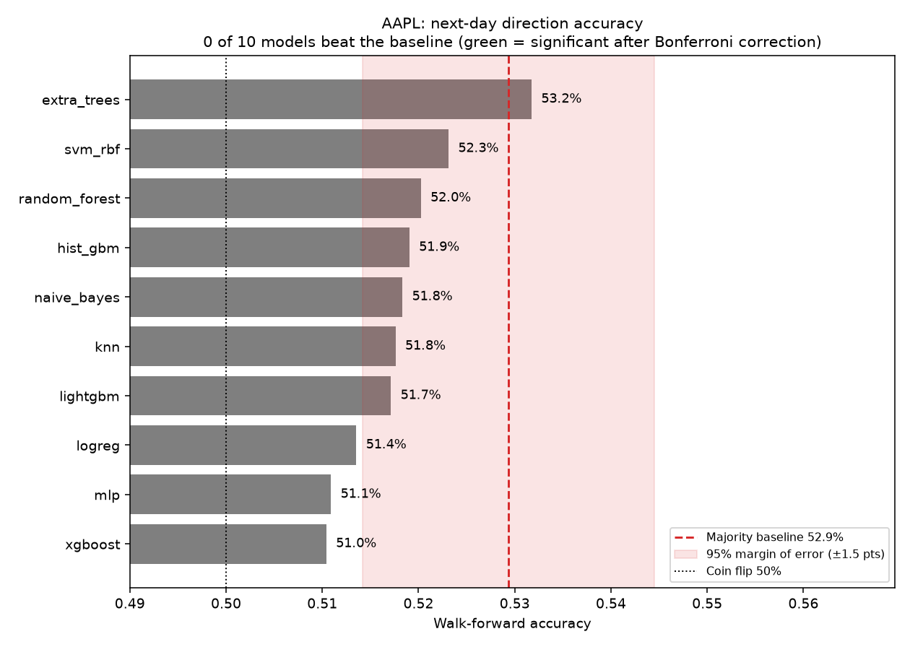
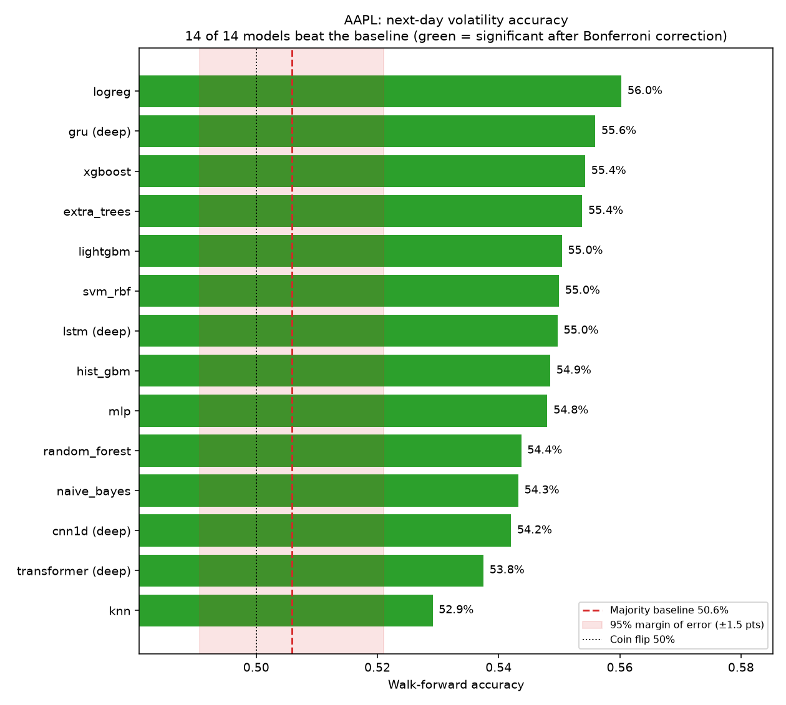

---

## Models compared

- **Classical (10):** logistic regression, SVM (RBF), k-nearest neighbours,
  Gaussian naive Bayes, random forest, extra trees, histogram gradient boosting,
  MLP, XGBoost, LightGBM.
- **Deep learning (4, PyTorch, 20-day windows):** LSTM, GRU, 1D CNN, Transformer encoder.
- **Ensemble:** average of all model probabilities.
- **Baseline:** always predict the majority class of the training data.

`--deep=all` adds 15 more neural variants (bidirectional, seq2seq, VAE, dilated CNN).
They were not run for the results below.

## Method

- **Data:** daily prices from yfinance, plus the S&P 500 and VIX.
- **Features:** lagged returns, 10/20-day returns, 5/20/60-day volatility, absolute
  returns, high-low range, volume change, moving-average gaps, RSI, market return,
  VIX change and level. All use data up to day t only.
- **Targets:** `dir` = next-day return > 0. `vol` = next-day absolute return above
  its trailing 60-day median.
- **Walk-forward:** train on everything before a block, test on the next block, move
  forward. Scaling is fitted on training data only. Tabular models use 252-day blocks;
  deep models use 504-day blocks and 5 epochs to keep runtime manageable.
- **Significance:** one-sided binomial test against the baseline accuracy,
  Bonferroni-corrected for the number of models.

---

## Result 1: next-day direction is not predictable

| | AAPL | MSFT |
|---|---|---|
| Baseline accuracy | 0.529 | 0.515 |
| Best model accuracy | 0.532 (extra trees) | 0.514 (extra trees, naive Bayes) |
| Models beating baseline (corrected) | 0 of 11 | 0 of 11 |
| AUC range | 0.49 to 0.51 | 0.49 to 0.51 |

Every model sits within noise of the baseline, and AUC is at chance. Models that
look "confident" are not better: the accuracy on their confident days is also near 0.52.

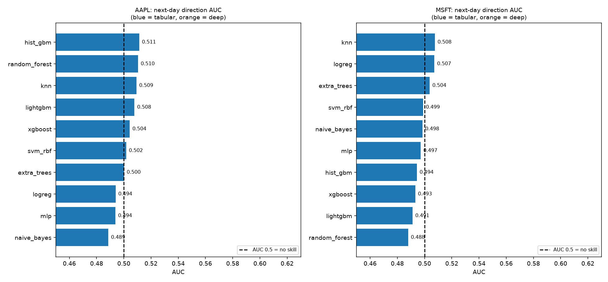

The long-or-flat backtest (no costs) does not change this. Differences from
buy-and-hold are noise because AUC is about 0.50.

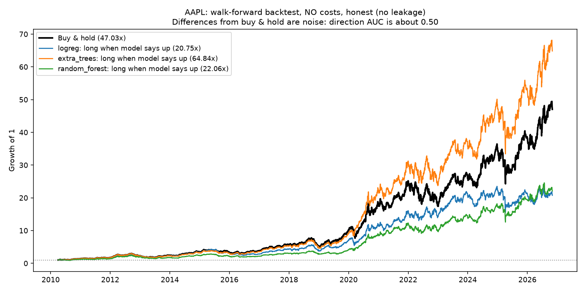

### What a predictor with no skill looks like

Most models predict "Up" almost every day, so accuracy lands near the share of up days.

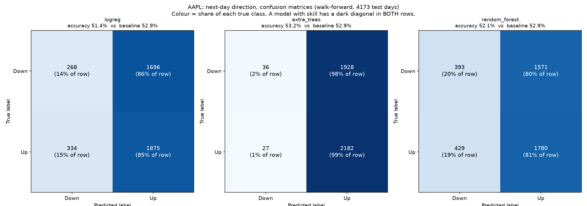

---

## Result 2: next-day volatility is predictable

Accuracy, tabular models (all 11 rows clear the corrected significance bar on both stocks):

| model | AAPL | MSFT |
|---|---|---|
| ensemble | 0.562 | 0.560 |
| logreg | 0.560 | 0.567 |
| xgboost | 0.554 | 0.551 |
| extra_trees | 0.554 | 0.551 |
| lightgbm | 0.550 | 0.550 |
| svm_rbf | 0.550 | 0.559 |
| hist_gbm | 0.549 | 0.548 |
| mlp | 0.548 | 0.546 |
| random_forest | 0.544 | 0.555 |
| naive_bayes | 0.543 | 0.531 |
| knn | 0.529 | 0.531 |
| **baseline** | **0.506** | **0.493** |

AUC is 0.55 to 0.60 for every model, against about 0.50 for direction.

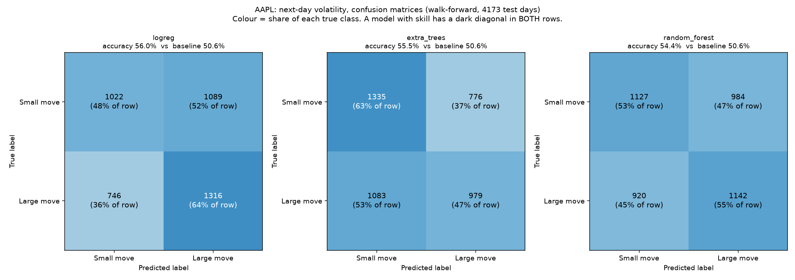

## Result 3: complexity does not help

Deep models on volatility:

| model | AAPL acc | AAPL AUC | MSFT acc | MSFT AUC |
|---|---|---|---|---|
| gru | 0.556 | 0.583 | 0.566 | 0.593 |
| lstm | 0.550 | 0.579 | 0.568 | 0.597 |
| cnn1d | 0.542 | 0.552 | 0.548 | 0.575 |
| transformer | 0.538 | 0.564 | 0.550 | 0.577 |
| *logreg (for comparison)* | *0.560* | *0.592* | *0.567* | *0.591* |

Logistic regression matches the best neural networks (AUC 0.592 and 0.591, against
0.583/0.593 for the GRU and 0.579/0.597 for the LSTM) and beats the CNN and Transformer.

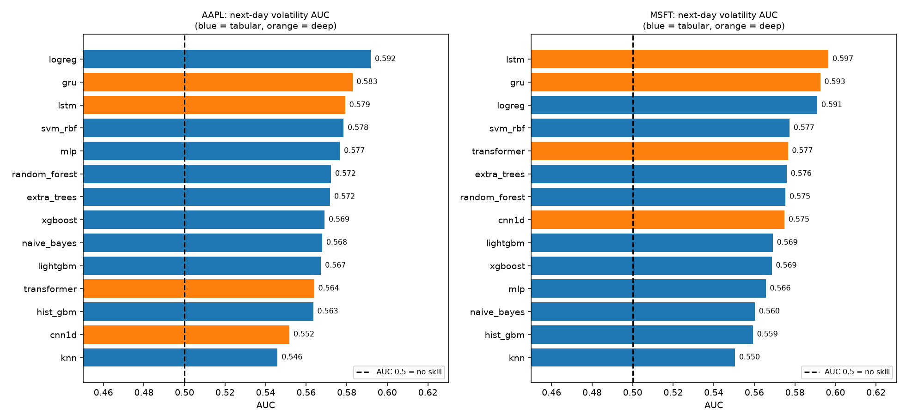

---

## Study: how leakage inflates accuracy

`leakage_study.py` repeats the direction task with common mistakes (AAPL, logreg and
extra trees):

| Scenario | Best accuracy | Baseline |
|---|---|---|
| 1. Honest next-day, walk-forward | 0.525 | 0.529 |
| 2. Random shuffle split, next-day | 0.524 | 0.527 |
| 3. 5-day labels, random shuffle (overlapping labels) | 0.595 | 0.582 |
| 4. 5-day, walk-forward with embargo (honest) | 0.574 | 0.575 |
| 5. Same-day market return as a feature | 0.707 | 0.530 |
| 6. Target not shifted (off-by-one bug) | 0.986 | 0.529 |

Honest setups stay at the baseline. Accuracy of 70% to 99% on stock direction almost
always means the answer leaked into the features. A shuffled split alone barely
inflates next-day accuracy, because daily returns are nearly independent; it matters
with overlapping labels (scenario 3).

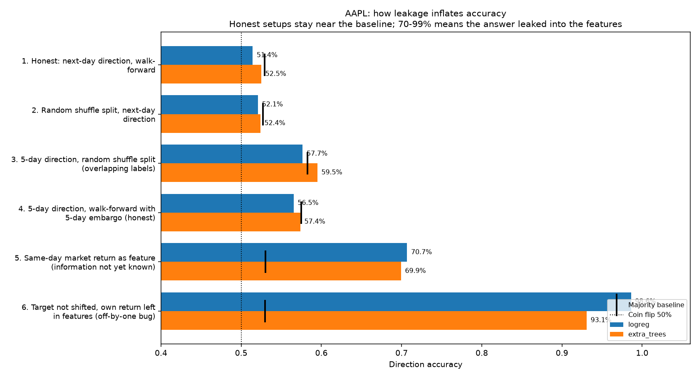

Predicting the next-day **price** also looks good for the wrong reason: tomorrow's
price is close to today's, so a chart of predicted against actual price hugs the line
even when the R-squared on returns is about zero.

---

## Study: stock ranking (cross-sectional)

Instead of one stock, rank 32 large US stocks and test whether the top 20% beat the
bottom 20% over 5 days (non-overlapping periods, 5 bps cost per side). These results
are from the October 2026 run and have not been refreshed.

| strategy | mean IC | IC t-stat | Sharpe gross | Sharpe net | turnover |
|---|---|---|---|---|---|
| f_momentum | 0.028 | 2.61 | 0.24 | 0.17 | 0.52 |
| hist_gbm | 0.017 | 2.15 | 0.27 | -0.08 | 2.27 |
| random_forest | 0.018 | 2.14 | 0.23 | -0.09 | 2.12 |
| mlp | 0.015 | 2.10 | 0.58 | 0.09 | 2.71 |
| extra_trees | 0.018 | 2.08 | 0.31 | 0.01 | 2.04 |
| ensemble | 0.017 | 2.06 | 0.25 | -0.07 | 2.19 |
| random (control) | 0.012 | 1.84 | 0.68 | 0.04 | 3.24 |
| f_lowvol | -0.006 | -0.54 | -0.06 | -0.10 | 0.43 |

No strategy passes the |IC t| > 3 bar. The random control scores close to the ML
models, and high turnover removes most gross returns. The universe is today's large
companies, so it has survivorship bias.

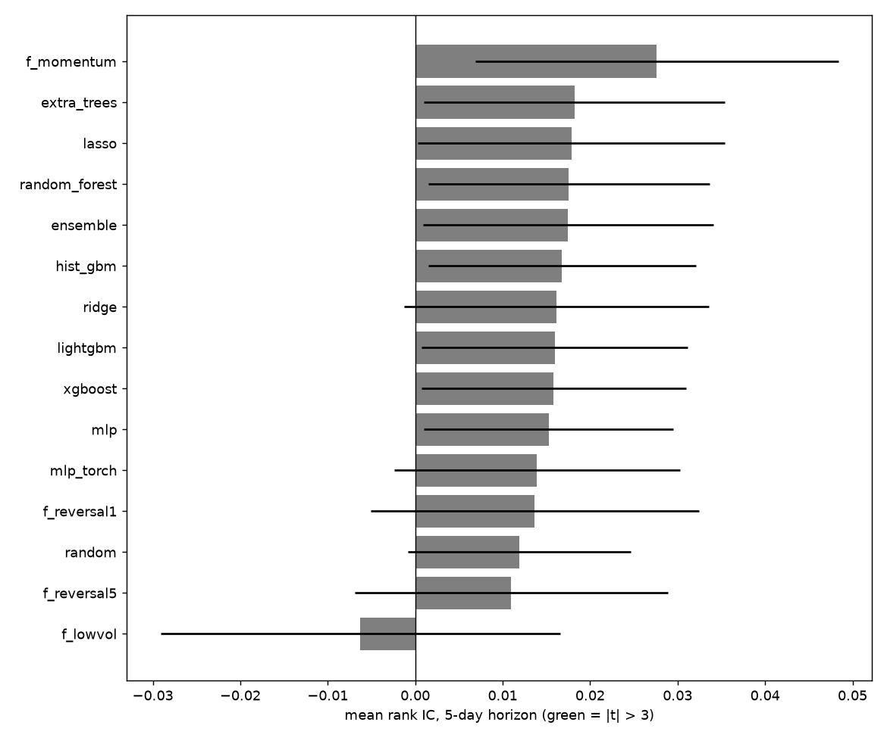
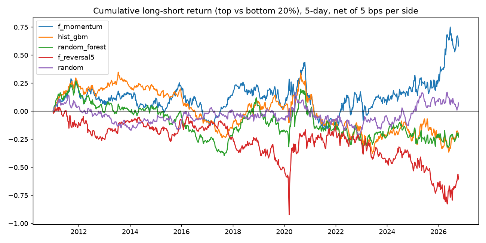

`rank_today.py` produces a daily ranking as a demo of the method. In backtests it was
not distinguishable from luck, so it is not advice.

---

## Further studies in this repo

| Script | What it does | Outputs |
|---|---|---|
| `predictability_map.py` | Logistic regression on 32 US and 30 Indian stocks, AUC per stock-year with a circular-shift null and false-discovery-rate control, by VIX regime | `pmap_*` |
| `global_risk.py` | Weekly volatility forecasts for 11 countries (equal-weighted baskets), cross-country ranking, inverse-volatility allocation backtest | `gr_*` |
| `hybrid_vol.py` + `backtest.cpp` | CNN-LSTM-attention volatility model on top of a HAR benchmark, with Diebold-Mariano tests and a C++ allocation backtest | `hyb_*`, `bt_input.csv` |

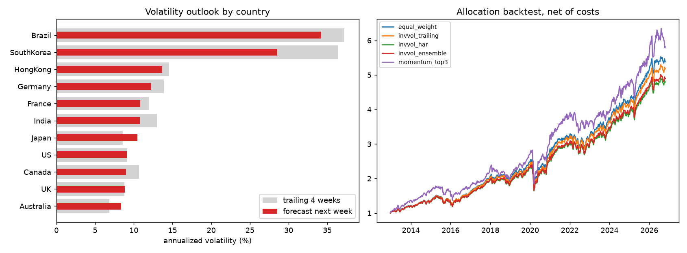
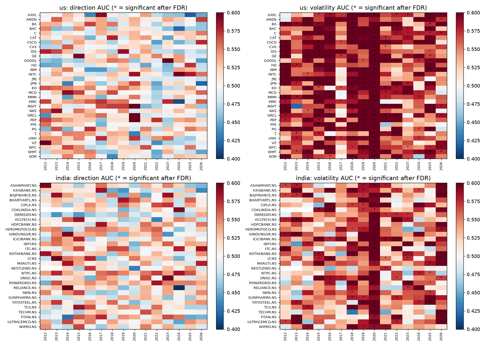

---

## Conclusions

1. Next-day direction is not predictable from price-based features on AAPL or MSFT.
2. Next-day volatility is predictable (AUC about 0.58), and the most useful use of
   it is risk sizing, not return prediction.
3. Complex models add nothing over logistic regression.
4. Impressive accuracy numbers usually come from leakage.

## Limitations

- **Volatility clustering.** Part of the volatility signal is persistence (quiet days
  follow quiet days). Features such as the 5-day average absolute return already
  encode it. A one-feature rule baseline (for example "5-day mean absolute return above
  its 60-day median", or "VIX above its median") has not been added to these tables, so
  the ML's gain over a simple rule is not yet measured.
- Two stocks over one period for the benchmark, 32 stocks for ranking. Results may not
  transfer. The ranking universe is today's large caps (survivorship bias).
- Price-based features only.
- The direction backtest ignores transaction costs and slippage.
- Deep models use coarser blocks and fewer epochs than the tabular models.
- The ranking results are from October 2026 data.

Nothing here is investment advice.

---

## Setup and run

    python3 -m venv venv
    source venv/bin/activate
    pip install -r requirements.txt

On macOS, XGBoost and LightGBM need OpenMP: `brew install libomp`. If a deep run
crashes with a segmentation fault, run it as
`KMP_DUPLICATE_LIB_OK=TRUE OMP_NUM_THREADS=1 python benchmark.py ...`.

    # Tabular models (fast)
    python benchmark.py --ticker=AAPL --target=dir --skip-dl --step=252
    python benchmark.py --ticker=AAPL --target=vol --skip-dl --step=252
    python benchmark.py --ticker=MSFT --target=dir --skip-dl --step=252
    python benchmark.py --ticker=MSFT --target=vol --skip-dl --step=252

    # Deep models, volatility only
    OMP_NUM_THREADS=1 python benchmark.py --ticker=AAPL --target=vol \
        --only=lstm,gru,cnn1d,transformer --step=504 --epochs=5 --tag=deep

    python summarize.py            # combined tables
    python plot_labeled.py         # labeled charts
    python leakage_study.py --step=252
    python predictability_map.py --shifts=100
    python global_risk.py
    python rank_benchmark.py --horizon=5 --skip-dl --stride=5 --step=252

Options: `--step`, `--epochs`, `--window`, `--skip-dl`, `--only=a,b`, `--seed`, `--tag`.
Outputs go to `results/`.
